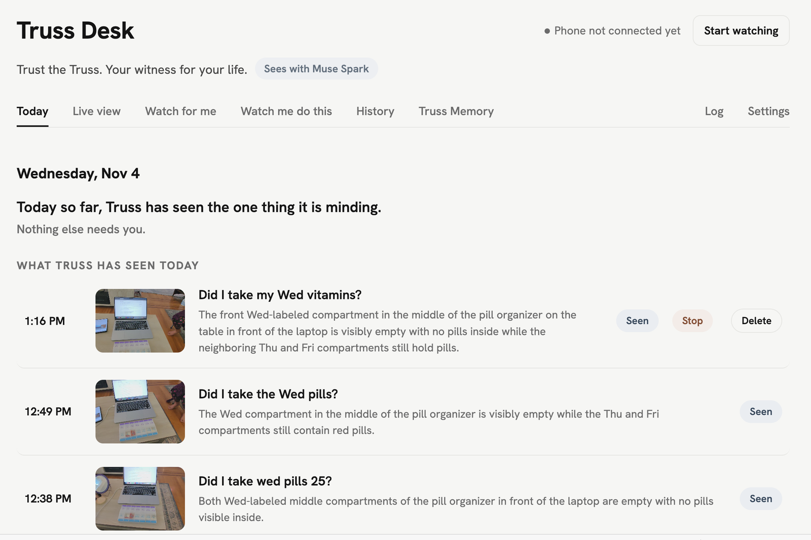
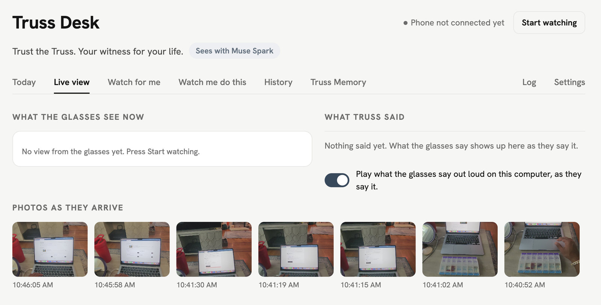
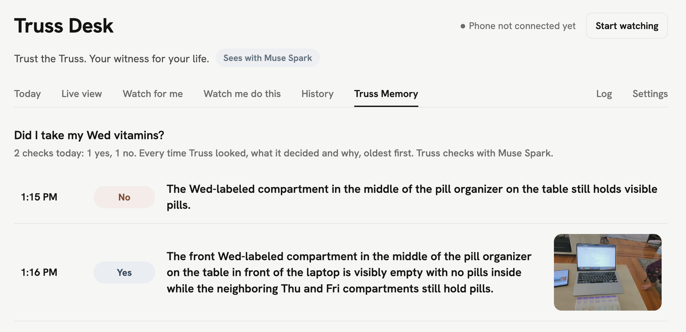
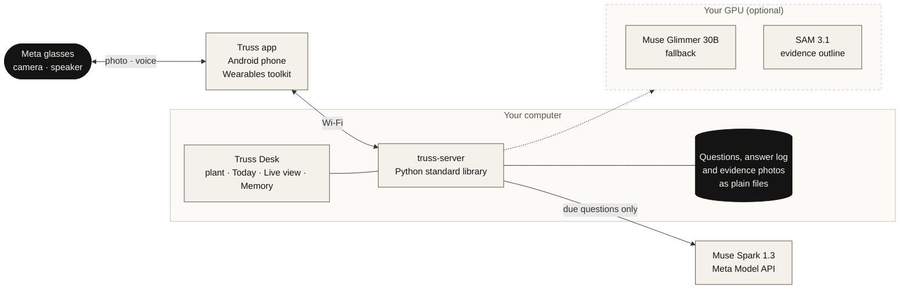

<p align="center">
  
</p>

<h1 align="center">Truss</h1>

<p align="center">
  <strong>"Did I already take my pills?" Truss saw.</strong><br>
  Ask once. Truss watches through your Meta glasses, speaks up the moment it sees the answer, and keeps the photo as proof.<br>
  Reach for a second dose, and it tells you that you already took them, and when.<br>
  <em>Trust the Truss. Your witness for your life.</em>
</p>

<p align="center">
  
  
  
  <a href="LICENSE"></a>
</p>

<p align="center">
  <a href="#get-started"><strong>Get started</strong></a> &nbsp;·&nbsp;
  <a href="#what-it-does">What it does</a> &nbsp;·&nbsp;
  <a href="#where-your-data-goes">Where your data goes</a> &nbsp;·&nbsp;
  <a href="#how-it-works">How it works</a>
</p>

<p align="center">
  
</p>

---

## Why

Some of the things we do every day are the ones we are least sure we did.
Did I turn the stove off? Did I take the pills, or was that yesterday? Did
anyone feed the dog? Looking again is easy. Trusting that you looked is not,
so you fret for an hour, or you do it again to be safe. A second dose is
where the harm is.

Truss does not sell seeing. Seeing is free. It sells remembering, at the
moment you are about to do it twice.

You plant a question once, with two photos from your own home: what yes
looks like and what no looks like. Then you go about your day wearing Meta
glasses. When a photo answers a question that is due, Truss speaks up first,
in your ear, without being asked, and the photo that answered it is
kept on your own computer. Photos that answer nothing are deleted.

A family member or a carer can plant the questions for someone else.

## What it does

- **Speaks first.** You never ask. When the glasses see the answer to a
  question that is due, Truss tells you, through the glasses.
- **Remembers what you did.** "Did I take my night pills?" is answered from
  what Truss saw inside the window, not from how the box looks now. Reach
  for the organizer again and Truss says you already took them, and when.
- **Says when it didn't see.** If a window closes with no sighting, you hear
  it once, with how much of the window was watched. It never says "you
  didn't", because you may have done it with the glasses off.
- **Keeps the proof.** Every answer comes with the photo it was seen in, the
  time, the reason in one sentence, and the model that made the call.
- **Truss Memory.** Pick a question and see every look Truss took at it
  today, oldest first, including the ones that found nothing, so you can see
  it was looking.
- **Would rather say "can't tell" than guess.** Every check is yes, no or
  cannot tell, with a reason. A failed call is never an answer.
- **Your home, your looks.** The reference photos are of your stove, your
  organizer, your door. Truss checks against those, not against a picture
  of a stove in general.
- **Cheap by design.** A photo is only checked against the questions due
  right now. Nothing due, no model call.

## See it

### What the glasses see

Live view on the Desk: each photo as it arrives from the glasses, and what
Truss said about it.

<p align="center">
  
</p>

### Truss Memory

Every check of one question today, oldest first: the time, what Truss
decided, why, and the photo when one was kept. Here, a no at 1:15 PM while
the compartment still held pills, then a yes at 1:16 PM once it was empty.

<p align="center">
  
</p>

<!-- Add the phone app here when a screenshot is ready: docs/screenshots/phone-home.png, width 320. -->

## Get started

Setup takes about 30 minutes. Three things, all on the same Wi-Fi network:

- **Meta glasses** that the Meta Wearables Device Access Toolkit supports,
  paired with the Meta AI app, with **Developer Mode** turned on in that
  app. Truss was built and tested on Oakley Meta Vanguard.
- **An Android phone** (Android 12 or newer) for the Truss app.
- **A computer** for the Truss server and the Truss Desk: macOS, Windows or
  Linux.
- **Python 3.12** on that computer (3.10 is the oldest that works). The
  server uses only the standard library, so there is nothing to
  `pip install`. Check with `python3 --version` (Windows: `py --version`).

  | | Install Python 3.12 |
  |---|---|
  | macOS | `brew install python@3.12`, or the installer from [python.org](https://www.python.org/downloads/) |
  | Windows | `winget install -e --id Python.Python.3.12`, or the python.org installer with **py launcher** ticked. Then open a new PowerShell window. |
  | Linux | `sudo apt install python3.12` (or your distribution's package) |

You also need a **Meta Model API key** (checks go to Muse Spark 1.3), and
Android Studio (Narwhal or newer, JDK 17, Android SDK 36) to build the app.

### 1. Start the server

```bash
git clone https://github.com/ClimbOutLabs/truss.git
cd truss/truss-server
python3 server.py
```

It listens on port 8792 and prints the address the phone and the Desk
should use. The first start may raise a firewall prompt: allow Python on
private networks, or the phone can't reach it.

<details>
<summary><strong>Windows</strong></summary>

In PowerShell, from your home folder (not `C:\Windows\system32`):

```powershell
cd $HOME
git clone https://github.com/ClimbOutLabs/truss.git
cd truss\truss-server
py server.py
```

`py` not recognized? Python 3.12 isn't installed yet (see the table
above), or the window was open before you installed it: open a new
PowerShell window. If only `python` works, use that instead of `py`.

Settings are set with `$env:NAME = "value"`, not `export`. Truss's voice
uses Windows' built-in speech; `TRUSS_VOICE` can name a voice such as
`"Microsoft Zira Desktop"`. Windows support is new: the full test suite passes
on a real Windows machine, but it has had less live use than the Mac, so
expect a few more bumps.

</details>

<details>
<summary><strong>Linux</strong></summary>

```bash
sudo apt install espeak-ng      # Truss's voice
cd truss/truss-server
python3 server.py
```

</details>

On a Mac, Truss speaks with the built-in `say`. For the most natural voice,
add a Premium or Enhanced English voice in System Settings > Accessibility >
Spoken Content > Manage Voices, then restart the server.

If the printed address is a VPN, Docker, WSL or Ethernet adapter rather
than your Wi-Fi, set `TRUSS_HOST` to the computer's Wi-Fi IP and restart.

### 2. Add your Meta key

Open the Desk at `http://<the printed address>:8792/desk` (the printed
address, not `localhost`). Go to **Settings**, paste the key, and press
**Test**. It is saved to `~/.truss/settings.json`, readable only by you,
and is never printed, logged or written into the repository.

Or set it in the shell before starting the server:

```bash
export TRUSS_META_API_KEY="<your key>"          # macOS, Linux
$env:TRUSS_META_API_KEY = "<your key>"          # Windows PowerShell
```

Read [Where your data goes](#where-your-data-goes) first: with the key set,
photos of due questions go to Meta's Model API.

### 3. Build the app

Open the **repository root** in Android Studio, let Gradle sync, plug in the
phone with USB debugging on, and Run the `app` configuration. Or from a
terminal: `./gradlew installDebug` (Windows: `.\gradlew.bat installDebug`).

With Developer Mode on in the Meta AI app, nothing else is needed. Without
it, add `mwdat_application_id` and `mwdat_client_token` from the Wearables
Developer Center to `local.properties`.

### 4. Connect everything

1. Open Truss on the phone and grant the Bluetooth permissions.
2. Tap **Connect glasses**. The Meta AI app opens; approve Truss and come back.
3. **Settings > Connections > Laptop address**: type the IP the server
   printed, then tap **Check connection**.

### 5. Plant a question

On the Desk, press **Watch for me**:

1. Type the question the way you'd say it: "Is the stove off?"
2. Show Truss yes and no: look at the thing with the glasses and press
   **Take the yes photo with the glasses**, then the same for no. Two JPEGs
   work too.
3. Choose when to look, tick **Be extra careful** for the stove, the pills
   or anything where a wrong answer could do harm, and press **Start
   watching for me**.
4. Wear the glasses and go look at it. Truss answers through the glasses.

More help: [troubleshooting](#troubleshooting) · [all settings](#settings) ·
[server details](truss-server/README.md) · [app details](app/README.md)

## Where your data goes

Photos go from the glasses to the phone to your computer. **From your
computer, each photo that a due question is checked against goes to Meta's
Model API (Muse Spark)**, with the question's words and, at planting, its
two reference photos. That is the one place anything leaves your home.

Be clear about one thing: this build ran on the hackathon's free API
credits, and Meta's billing page says that while free credits are in use,
content may be used for product improvement. In that configuration, those
photos and words can be used by Meta.

To keep everything at home, leave the Meta key unset and serve Muse Glimmer
30B on your own GPU ([below](#run-the-models-at-home)): every call then goes
there, through the same code.

The kept record stays on your computer as plain files: the evidence photos
and a plain-text answer log per day. A photo no question fires on is
deleted after its check. The app talks only to your computer: no cloud
SDKs, no analytics. There is no speech to text; nothing you say is recorded.

## Built on Meta

| Model | Where it runs | What it does |
|---|---|---|
| **Muse Spark 1.3** (`muse-spark-1.3`, standard tier) | Meta Model API | Every check, and the plant-time compile of each question's looks |
| **Muse Glimmer 30B** (open weights, GGUF Q4_K_M) | Your own GPU, under llama.cpp's `llama-server` | Fallback when the API fails; every call when no Meta key is set |
| **SAM 3.1** (open weights, `facebook/sam3.1`) | Your own GPU, a small HTTP service (`dgx/sam/`) | Outlines the object in kept evidence photos (optional) |
| **Wearables Device Access Toolkit** (`mwdat-core`, `mwdat-camera` 1.0.1) | The phone | Photos and video from the glasses, and whether they are being worn |

Rules Truss holds itself to, in code:

- No non-Meta model makes any check, compile or outline.
- Never the Muse Spark contributor tier, which trains on what it is sent.
  Any model name containing `contributor` is refused before anything is sent.
- The Meta key is only ever sent over https to the Meta Model API, never to
  the local fallback.

## How it works



- **The phone** watches hands-free. In live view it keeps the glasses video
  open and sends a photo when the view changes and holds still; in timed
  photos it takes one every 15, 30 or 60 seconds and skips one nearly
  identical to the last. It pauses while the glasses are off your face.
- **The server** keeps each question as a plain folder: its words, the yes
  and no photos, when to watch, and what planting learned. Only questions
  that are due ever see a photo, and a question rests once it has fired.
- **A check** is one OpenAI-compatible `chat/completions` call with image
  inputs and a strict JSON reply: `yes`, `no` or `cannot_tell`, with a
  one-sentence reason. All questions due on a photo go in one call; a
  safety question is always asked alone.
- **Planting** makes one call that writes, in words, what tells this home's
  yes-look from its no-look ("both knobs point to OFF"), plus short object
  names for SAM. Checks then read the photo with those words.
- **Truss's voice** is your computer's own text to speech, played through
  the phone to the glasses.

### Two kinds of question

- **State questions** ask how the world is now: is the stove off, is the
  door locked. The current photo answers them.
- **Done questions** ask about something you did: did I take my night
  pills. The current state can lie (a fed dog's bowl is empty an hour later
  because the dog ate), so the answer comes from what Truss witnessed. A
  done question has a window, such as 9 to 10 PM. The first time the
  glasses see the yes-look inside it, Truss keeps that photo and its time
  as the witness. If the window closes with no witness, an alert is raised
  that survives restarts and clears only when the phone confirms it was
  spoken.

Truss uses done questions only where the act leaves a trace that stays: a
compartment that goes empty, a deadbolt that turns. Pills taken from a
bottle need act recognition, which Truss does not attempt.

### Safety

The failure designed against is a wrong all-clear, above all on the stove
and the pills.

- **Cannot tell, instead of a guess.** A yes or no with no reason is read as
  cannot tell. A check that fails for any reason (timeout, a reply cut off,
  invalid JSON) is never a verdict.
- **Description over verdict.** A missed pills window never says "you didn't
  take your pills". It asks you to look ("Could you have a quick look at the
  Tuesday PM compartment yourself before you act on this?"), and a test
  fails the build if any alert sentence holds an action verb such as take,
  turn, feed or lock (`truss-server/test_safety.py`).
- **Coverage is stated.** A missed-window alert says how much of the window
  was really watched, counted from the photos actually checked.
- **Extra careful questions think harder.** Muse Spark runs at a higher
  reasoning effort for them.

Truss reduces fretting and redoing. It is not the last line of defense on a
stove.

### Cost

The expensive thing, a model looking at a photo, is made rare by gates
that cost nothing: a photo is checked only against questions due now; a
question rests once it has answered; and the phone skips a photo whose
16 by 16 grey thumbnail is within 8 levels of the last one sent in the past
two minutes. A photo-a-second design was costed and rejected.

Over the API, a check is priced at Muse Spark 1.3 standard rates ($1.25 per
million input tokens, $4.25 per million output). Run at home, the cost is
the GPU's electricity for the seconds a check takes. In the first live
end-to-end run, on Muse Glimmer at home, a glasses photo took 11 to 13
seconds from arriving at the computer to the verdict, and about 15 seconds
to Truss speaking. Measured per-day cost and battery per hour of wear are
not reported yet.

## For developers

### Run the models at home

On an NVIDIA DGX Spark or a Linux machine with a CUDA GPU and about 24 GB of
memory:

```bash
./dgx/bringup.sh all            # downloads Glimmer, builds llama.cpp, serves on :8080
./dgx/sam/setup.sh all          # optional: SAM 3.1 for evidence outlines, on :8090
```

Then, where the server runs, set `TRUSS_BASE_URL=http://<gpu-machine>:8080/v1`
(and `TRUSS_EVIDENCE_OUTLINE=1`, `TRUSS_SAM_URL=http://<gpu-machine>:8090`
for outlines) and restart. With the Meta key also set, Glimmer is the
fallback; with it unset, nothing leaves your home. Details:
[`dgx/RUNBOOK.md`](dgx/RUNBOOK.md) and [`dgx/sam/RUNBOOK.md`](dgx/sam/RUNBOOK.md).

### Tests

Plain Python, standard library only:

```bash
cd truss-server
for t in test_*.py; do python3 "$t" || echo "FAILED: $t"; done
```

On Windows: `Get-ChildItem test_*.py | ForEach-Object { py -X utf8 $_.Name }`.

`eval/` is a harness of 21 staged household questions, five of them safety
questions, with tuning and held-out frames and the safety false all-clear
rate reported on its own ([`eval/RUNBOOK.md`](eval/RUNBOOK.md)). Its numbers
are not reported yet.

<details id="settings">
<summary><strong>Settings</strong></summary>

All are environment variables read when the server starts. Only the Meta
key is needed for a first run.

| Variable | Default | What it does |
|---|---|---|
| `TRUSS_META_API_KEY` | unset | The Meta key. Turns on Muse Spark 1.3. Sent over https only. |
| `TRUSS_META_MODEL` | `muse-spark-1.3` | The Muse Spark model. The contributor tier is always refused. |
| `TRUSS_META_REASONING_EFFORT` | `low` | How hard Muse Spark thinks on an ordinary check: `minimal`, `low`, `medium`, `high`, `xhigh`, or `default`. Lower is faster. |
| `TRUSS_META_SAFETY_REASONING_EFFORT` | `medium` | The same, for a question marked extra careful. |
| `TRUSS_META_TIMEOUT_S` | `120` | Longest wait for one Muse Spark call. |
| `TRUSS_HOLD_ON` | off | `1` lets Truss say "Hold on, let me check something." when you reach for the thing a question is about, then give the answer. A done question already seen is then reminded every time it is in shot again. Needs an app built from the same commit. |
| `TRUSS_BASE_URL` | unset | The local fallback, Glimmer under `llama-server`. |
| `TRUSS_EVIDENCE_OUTLINE` / `TRUSS_SAM_URL` | off / `http://127.0.0.1:8090` | Outline the object in kept evidence photos with SAM 3.1. |
| `TRUSS_REFUSALS` | `1` | Truss says when it can't see the deciding detail ("I can't see the knobs from here"). `0` keeps every cannot-tell silent. |
| `TRUSS_BATCH_CHECKS` | `1` | All questions due on a photo in one call. `0` asks each separately. |
| `TRUSS_HOST` | found by itself | The address to listen on. `0.0.0.0` listens on all. |
| `TRUSS_VOICE` / `TRUSS_VOICE_RATE` | best installed / system | Truss's voice by name, and words per minute (macOS and Linux). |
| `TRUSS_SETTINGS` | `~/.truss/settings.json` | Where the Desk saves its settings. |
| `TRUSS_PLANT_MINUTES` / `TRUSS_BEDTIME_AFTER` | `15` / `20:00` | For quick live tests only. |

The full list is in [`truss-server/README.md`](truss-server/README.md).

</details>

<details id="troubleshooting">
<summary><strong>Troubleshooting</strong></summary>

- **The phone can't reach the computer.** Same Wi-Fi for both, and the
  firewall must allow Python. If the printed address isn't the Wi-Fi
  address, set `TRUSS_HOST`. Open `http://<address>:8792/` in the phone's
  browser: it should say the server is running.
- **The Desk won't open on `localhost`.** The server listens only on the
  network address it printed. Use that.
- **Truss never speaks.** With the server running and the app open, run
  `python3 truss-server/preflight.py` (Windows: `py -X utf8 truss-server\preflight.py`).
  Every FAIL line says how to fix it. The Desk's **Log** tab shows each check
  as it happens.
- **Every answer is "cannot tell" naming Muse Spark.** The key is missing
  or refused: test it on the Desk's Settings tab. A key saved on the Desk
  is not read by command-line tools such as `endpoint.py --smoke`; set
  `TRUSS_META_API_KEY` in that shell too.
- **The glasses take no photo.** Check Developer Mode in the Meta AI app,
  then tap **Connect** again under Settings > Connections. Truss pauses while
  the glasses are off your face.

</details>

<details>
<summary><strong>The Desk, tab by tab</strong></summary>

- **Today**: every question by time, with how it stands in a word
  (Watching, Needs its photos, Not seen, Yes), samples one click from
  planting, and a banner for any missed-window alert.
- **Watch for me**: plant a question.
- **Live view**: what the glasses see now, and what Truss said. It can play
  Truss's lines on the computer too.
- **Watch me do this**: a guided task, one step at a time, each step checked
  before the next.
- **History**: a day's answers with their evidence photos.
- **Truss Memory**: every check of one question today, oldest first.
- **Settings**: the Meta key and who answers the checks, each with a Test button.
- **Log**: the server's log, without a terminal.

</details>

<details>
<summary><strong>Repository layout</strong></summary>

| Path | What |
|---|---|
| `app/` | Android app (Kotlin, Compose, Meta Wearables toolkit) |
| `truss-server/` | Server and Desk: question store, check loop, done windows, alerts, voice, evidence |
| `dgx/` | Bring-up and bench scripts for Muse Glimmer 30B under `llama-server` |
| `dgx/sam/` | Local SAM 3.1 service, its setup script and acceptance run |
| `eval/` | Eval harness: question set, capture tool, runner, scorer |
| `docs/` | Images for this README |

</details>

## Beyond the demo

- **Any camera.** Nothing in the server knows the photos come from glasses:
  a question, its two looks, and a frame. A fixed camera at home could feed
  the same questions.
- **An assistant that plants for you.** An assistant that knows your day
  could ask "want me to keep an eye on the stove?" and plant the question
  itself.
- **The guide.** `truss-server/guide.py` talks you through a job one step at
  a time, each step checked by eye before the next. It never makes a safety
  call and keeps no photos.

## Built during the event

Truss was built for the Meta Global AI Developer Hackathon (Indie track,
"Build for Your World"). All code here was written during the event, which
began October 26, 2026; the first commit is from October 27. Pre-existing
pieces it relies on:

- Meta's Wearables Device Access Toolkit; the app's registration and
  permission flow follows its CameraAccess sample.
- llama.cpp and the SAM 3 code from `facebookresearch/sam3`, installed by
  the scripts, not vendored.
- Hanken Grotesk, under the SIL Open Font License
  ([`third_party/fonts/`](third_party/fonts/)).
- Before Glimmer was running locally, early end-to-end checks went through a
  bridge to the author's own local assistant, a separate project from before
  the event that runs a non-Meta model (`truss-server/aman_check.py` and
  `eval/aman_truss_spike.py`). It is off by default, never used in the demo
  or the eval, and nothing it answered counts as a Truss result.

## License

MIT. See [`LICENSE`](LICENSE). The Hanken Grotesk font files keep their own
SIL Open Font License.
